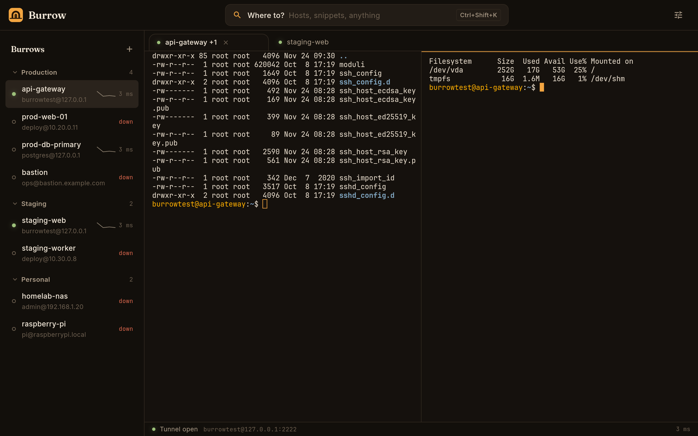

# Burrow SSH

Open source, self-hostable SSH client in the spirit of Termius. One Flutter codebase for iOS, Android, macOS, Windows and Linux, with the SSH engine and sync server in Rust. The optional sync server only stores end-to-end-encrypted data.

See [docs/PLAN.md](docs/PLAN.md) for the architecture and roadmap.



## Design
Burrow has its own look, deliberately warm and earthy rather than the cool navy of most SSH clients.
- **Palette:** Loam (dark, warm brown-black) and Sand (light, warm paper) with one ember accent and clay as a second tone. Terminal themes: Loam, Sandstone, Moss, Ember.
- **Type:** Fraunces for headings, Inter for UI, JetBrains Mono in the terminal.
- **Mark:** a tunnel entrance of nested arches on a ground line (`assets/icon/icon.png`, drawn in code by `BurrowMark`).
- **Palette first:** "Where to?" (⌘K, Ctrl+Shift+K elsewhere) sits at the top and handles hosts, snippets, tabs, themes and settings. The sidebar of Burrows (host groups) hides with ⌘B.
- **Signature details:** a tunnel animation while connecting, inline health per host (TCP round trip and a tiny history, checked every 20 s), arch-shaped tabs, and underground illustrations for empty states.
- **Voice:** friendly but clear. Buttons say exactly what they do.
- **Mobile:** Burrows list with health, "Where to?" search at the bottom for thumbs, full-screen terminal with a key bar (esc, sticky ctrl, tab, arrows, symbols).

## Layout
```
apps/client         Flutter app (xterm.dart terminal)
  lib/ui/desktop    Sidebar, tabs, split panes, command palette
  lib/ui/mobile     Host list, terminal, key bar
  lib/state         Hosts/settings store and open sessions
apps/client/rust    Bridge crate exposed to Dart via flutter_rust_bridge
crates/core         SSH sessions (russh), UI-independent
crates/proto        Wire types shared by the app and the server
server              Sync server (Axum + SQLite)
```

## Run the app
Needs Flutter 3.50+ (stable), Rust (rustup), and each platform's toolchain (Xcode, Android Studio, etc.).
```sh
cd apps/client
flutter run -d macos        # or ios, android, windows, linux
```
Cargokit builds the Rust crate automatically. After changing `apps/client/rust/src/api`, regenerate bindings:
```sh
cargo install flutter_rust_bridge_codegen --version 2.13.0
cd apps/client && flutter_rust_bridge_codegen generate
```

## Run the sync server
```sh
cargo run -p burrow-server            # listens on :8080, stores burrow.db
# or
docker build -f server/Dockerfile -t burrow-server .
docker run -p 8080:8080 -v burrow:/data burrow-server
```
Put it behind a TLS reverse proxy (Caddy, nginx) for real use.

## Status
Early scaffold: single connection with password or key. Host key checking is not done yet, so do not use it on untrusted networks.
